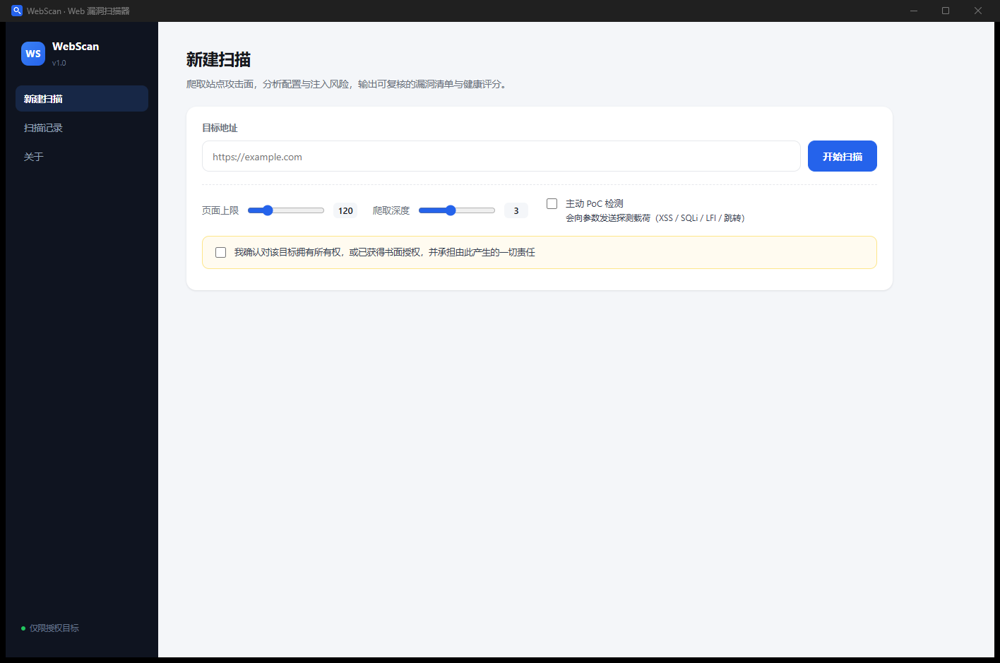

# WebScan 1.0 · Web 漏洞扫描器

- 开工日期：2026-10-29
- 状态：**可运行 + 已打包为桌面程序**（功能一完成；`dist\WebScan\WebScan.exe` 双击即用，
  独立窗口 + 托盘，不再依赖浏览器）
- 课题：30 网站漏洞扫描系统（功能二"实时监控响应"暂缓，见 `docs/02`）

## 一句话

输入一个（已授权的）网址，爬取攻击面，输出分级漏洞清单 + 可复算的健康评分，可导出报告。



## 三种启动方式

```powershell
# A. 直接双击打包好的程序（绿色版，无需装 Python；Qt 独立窗口）
dist\WebScan\WebScan.exe

# B. 从源码启动（同样打开 Qt 窗口）
powershell -File scripts\run.ps1 -Port 8770

# C. 命令行扫一次
python -m webscan --scan http://127.0.0.1:8899/ --deep
```

想让界面回到浏览器标签页：给 A/B 加 `--browser` 参数。

配套的本地漏洞靶站（测试用）：

```powershell
powershell -File scripts\run_lab.ps1 -Port 8899
```

本地地址：<http://127.0.0.1:8770/>　单元测试：`python -m unittest discover -s tests -v`

## 打包

```powershell
powershell -File scripts\build_exe.ps1
# 产物：dist\WebScan\（整个目录压缩即绿色版，约 600 MB，主要是 Qt + Chromium）
```

详见 [软件化说明](docs/04-软件化说明.md)。

## 边界与红线

1. **只扫描自己拥有或已获明确书面授权的目标。** 未授权扫描他人站点在国内涉及
   《网络安全法》《刑法》285/286 条。产品层面已做成硬约束：不勾选授权确认就无法提交任务。
2. 默认每主机限速 6 请求/秒，默认只读；主动 PoC 需显式开启。每次请求（含跳转）都检查目标主机和端口，同主机默认端口允许从 HTTP 升级到 HTTPS。
3. 不实现漏洞利用、写入/删除、密码爆破、WAF 对抗。
4. 扫描结果可能含敏感信息，本地保存，禁止外传。
5. 服务只监听 `127.0.0.1`，校验 Host 头 + 一次性令牌，防 DNS rebinding 与本地跨站调用。

## 目录

| 路径 | 用途 |
| --- | --- |
| `webscan/` | 主体代码（引擎 + 规则 + Web 服务 + 前端 + 托盘） |
| `labs/` | 故意含漏洞的本地靶站 |
| `docs/` | 设计大纲、问题清单、实现说明、软件化说明 |
| `scripts/` | 启动 / 靶场 / 打包 / 图标脚本 |
| `tests/` | 单元测试 |
| `dist/` | 打包产物（构建生成） |
| `data/` | SQLite 与导出报告（运行时生成） |

## 文档

- [总体设计大纲](docs/01-总体设计大纲.md)
- [设计问题与对策](docs/02-设计问题与对策.md)
- [初版实现说明](docs/03-初版实现说明.md) —— 规则清单、实测数据、误报修正记录
- [软件化说明](docs/04-软件化说明.md) —— 打包、托盘、单实例、启动失败排查

## 已知限制

只测 GET 参数与 GET 表单；无登录态；不渲染 JS（SPA 覆盖有限）；无盲注检测。HTML 中原样回显脚本会报告为疑似 XSS，需用浏览器进一步确认。单页最多保留 512 KiB 正文，超出会在界面计数。
详见 `docs/03-初版实现说明.md` 第 7 节。

## 下一步

1. POST 表单 + 登录态
2. Playwright 渲染分支（SPA）
3. 误报白名单
4. 报告按 OWASP Top 10 归类

## 免责声明

本项目是课程作业与安全学习用途的**授权测试工具**。

- 只允许对**你本人拥有**，或**已取得书面授权**的站点使用。
- 未经授权对他人系统进行漏洞扫描，在国内可能违反《中华人民共和国网络安全法》
  《刑法》第 285、286 条，在其他司法辖区同样可能构成犯罪。
- `labs/vuln_app.py` 是**故意包含漏洞**的本地靶站，仅绑定 `127.0.0.1`，
  请勿部署到公网或用于任何真实业务。
- 使用者对自己的一切行为负责，作者不承担任何由误用、滥用造成的直接或间接责任。

## License

[MIT](LICENSE)
